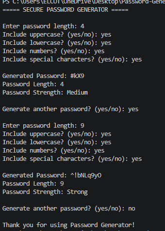

# 🔐 Secure Password Generator

A Java-based Secure Password Generator that creates random passwords using user-selected character types.

## ✨ Features

- Generate random passwords.
- Customize password length.
- Include uppercase and lowercase letters.
- Include numbers and special characters.
- Uses SecureRandom for secure generation.
- Password strength checker (Weak, Medium, Strong).
- Generate multiple passwords.
- Input validation.

## 🛠️ Technologies Used

- Java
- SecureRandom
- ArrayList
- StringBuilder
- Collections
- Scanner

## 📂 Project Structure

```text
Password-Generator/
├── PasswordGenerator.java
├── Password-Output.png.png
└── README.md
```

## ▶️ How to Run

**Step 1:** Open the project folder.

**Step 2:** Compile the program.

```bash
javac PasswordGenerator.java
```

**Step 3:** Run the program.

```bash
java PasswordGenerator
```

## 🧠 Java Concepts Used

- Classes and Methods
- Loops and Conditional Statements
- Strings and StringBuilder
- ArrayList and Collections
- SecureRandom
- Input Validation

## 📸 Sample Output



## 🎯 Learning Outcomes

- Understanding random password generation.
- Working with Java collections.
- Implementing input validation.
- Checking password strength.
- Developing a console-based application.

## 👩‍💻 Author

**Durgalakshmi M**

GitHub: [durgalakshmim-2007](https://github.com/durgalakshmim-2007)

---

⭐ Thank you for visiting this project!
